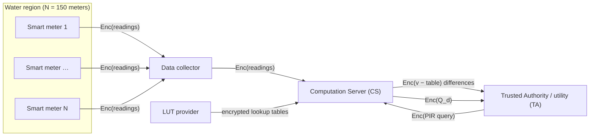

# Architecture

This document explains how SmartWaterMeter computes the daily Harmonic Mean / Arithmetic Mean ratio of a region's water consumption without ever decrypting an individual meter's reading. The math behind each step, and the threat model, are in [SYSTEM_MODELS.md](SYSTEM_MODELS.md).

### System context



The project report draws the same parties as four boxes (data collection, LUT, computation server, water center). The diagram above adds the exchange between the CS and the TA, which is where every lookup happens.

### Parties

The simulation models the components described in the project report. Each `StepN_XXX` program in `src/` is named after the party that runs it.

| Party | Code prefix | Holds | Role |
|---|---|---|---|
| Smart Meters | (simulated inside `Step1_CS1`) | Public key | Encrypt each meter's hourly usage at the source. |
| Data Collector | (simulated inside `Step1_CS1`) | Nothing secret | Forward encrypted readings to the computation server. |
| Computation Server | `CS` | Public, relinearization and Galois keys | Performs every homomorphic computation on ciphertexts. Never needs the secret key. |
| Trusted Authority / Utility Provider | `TA` (log messages sometimes say `DS`) | Secret key | Decrypts only *table-search differences* to locate a lookup-table index, then returns an encrypted PIR query. Decrypts the final result. |
| LUT Provider | `MakeEncTab_*` | Public key | Builds the encrypted lookup tables ahead of time. |

The CS and TA take turns: every CS step produces files that the next TA step reads, and vice versa. In this simulation the parties exchange data through files on disk (see [PROGRAMS.md](PROGRAMS.md)).

### Keys and trust boundaries

`KeyGen` produces four keys. In the intended deployment each party receives only the keys it needs:

| Key | Used for | Given to |
|---|---|---|
| Public key | Encryption | Smart meters, LUT provider, TA (to encrypt PIR queries) |
| Secret key | Decryption | TA only |
| Relinearization key | Shrinking ciphertexts after a multiplication | CS |
| Galois keys | Slot rotations (PIR, rotate-and-add sums) | CS |

The secret key is the only trust boundary that matters: whoever holds it can decrypt any ciphertext. The design keeps it away from the CS, so the server that sees every reading can read none of them. The TA holds the key but only ever receives aggregate differences, never a single meter's ciphertext. See the [threat model](SYSTEM_MODELS.md#threat-model) for what each party learns.

In this simulation all parties share one `Key/` folder, so the separation exists only by convention.

### What is computed

For `N` meters (`METER_NUM = 150`) and hourly time slots `t = 0..23`, with `w_i(t)` the reading of meter `i` in slot `t`, the code works on the log-transformed value `ln(w_i(t) + 2)`:

```
AM_t = (1/N) · Σ_i ln(w_i(t) + 2)                 (Arithmetic Mean of slot t)
HM_t = N / Σ_i ( 1 / ln(w_i(t) + 2) )             (Harmonic Mean of slot t)

Q_d  = Σ_t HM_t / Σ_t AM_t                         (daily HM/AM ratio for day d)
```

`Q_d` is the value the utility uses to detect anomalies. False-data-injection attacks (additive, deductive and camouflage attacks) shift the HM and AM differently, so the ratio moves even when the mean is kept the same. The plaintext reference value of `Q_d` is computed by `Step1_CS1` and written to `ptxt_res/`. The encrypted pipeline result is written by `CheckRes` to `ctxt_res/` so the two can be compared.

### Why lookup tables (LUT) and PIR

BFV supports only addition, subtraction and multiplication on integers. Division, `1/x`, and rescaling all need another method. The project uses the **LUT + PIR** approach from the smart-grid work it is based on:

1. **Table search.** The LUT provider publishes an encrypted *input table* of every possible value `x_k` and an encrypted *output table* holding `f(x_k)`. The CS subtracts the encrypted input table from the encrypted value `v`. The CS cannot read the result.
2. **Index lookup.** The TA decrypts the differences `v − x_k`. The slot that is `0`, or where the sign changes from positive to negative (rounded to the nearer one), is the index `k` of `v` in the table. The TA learns only *where* the aggregate falls in the table, never an individual reading.
3. **PIR query.** The TA encrypts a one-hot vector for the column of `k` and a rotated copy that encodes the row (`ShiftWork`), and sends both to the CS.
4. **Retrieval.** For each table row `j`, the CS rotates the row query by `−j`, multiplies it by the column query (a one-hot vector survives only in the matching row) and multiplies the result by output-table row `j`. Summing over rows, then a log-step rotate-and-add, puts `Enc(f(x_k))` in every slot. The CS still does not know `k`.

### Pipeline

```
 KeyGen ──► MakeEncTab_1 (LUT provider)
                │
 Step1_CS1   meters encrypt round(2^5·ln(w+2)) and round(2^10/ln(w+2));
             CS sums over N meters per hour; subtracts AM_input / HM_input tables
 Step2_TA1   TA finds the index of each hourly sum, sends PIR queries
 Step3_CS2   CS retrieves AM_t and HM_t from AM_output / HM_output, sums over 24 hours,
             subtracts SUM_AM_input / div_HM_input tables
 Step4_TA2   TA finds the index of ΣAM and ΣHM, sends PIR queries
 Step5_CS3   CS retrieves 1/ΣAM and ΣHM, each split into two base-100 digits,
             multiplies them, subtracts inv_100_input table
 Step6_TA3   TA finds the index of the cross term, sends a PIR query
 Step7_CS4   CS retrieves (cross term / 100) and adds the high-order term → Enc(Q_d · scale)
 CheckRes    TA decrypts and rescales → Q_d
```

The same pipeline as a sequence of messages, for one day:

```mermaid
sequenceDiagram
    autonumber
    participant M as Smart meters
    participant LUT as LUT provider
    participant CS as Computation Server
    participant TA as Trusted Authority
    Note over TA: KeyGen: public, secret,<br/>relinearization, Galois keys
    LUT->>CS: encrypted AM/HM, SUM_AM, div_HM, inv_100 tables
    M->>CS: Enc(round(2^5·ln(w+2))), Enc(round(2^10/ln(w+2)))
    Note over CS: Step 1: sum over meters per hour,<br/>subtract AM_input / HM_input
    CS->>TA: hourly differences
    Note over TA: Step 2: find index, build PIR query
    TA->>CS: Enc(query) for each hour
    Note over CS: Step 3: retrieve AM_t, HM_t, sum over 24 h,<br/>subtract SUM_AM_input / div_HM_input
    CS->>TA: daily differences
    Note over TA: Step 4: find index, build PIR query
    TA->>CS: Enc(query) for ΣAM and ΣHM
    Note over CS: Step 5: retrieve A1, A2, H1, H2;<br/>res1 = A1·H1, res2 = A1·H2 + A2·H1;<br/>subtract inv_100_input
    CS->>TA: res2 differences
    Note over TA: Step 6: find index, build PIR query
    TA->>CS: Enc(query) for res2
    Note over CS: Step 7: retrieve res2/100, add res1
    CS->>TA: Enc(Q_d · 2^30 / 10^4)
    Note over TA: CheckRes: decrypt, rescale, compare<br/>with the plaintext Q_d from Step 1
```

### Integer encoding and precision

BFV works on integers modulo the plain modulus `t = 786433`. Every real value is therefore scaled by a power of two and rounded:

| Quantity | Encoding | Defined in |
|---|---|---|
| Per-meter AM input | `round(2^5 · ln(w+2))` (`PRECISION`) | `SGSimulation.hpp`, `Step1_CS1` |
| Per-meter HM input | `round(2^10 / ln(w+2))` (`PRECISION2`) | `SGSimulation.hpp`, `Step1_CS1` |
| Hourly `AM_t`, `HM_t` (output tables) | scaled by `2^9` | `MakeEncTab_1` |
| `1/ΣAM` (output table) | `2^21 / (ΣAM / 2^9)` = `2^30 / ΣAM` | `MakeEncTab_1` |
| Final result | `Q_d = dec · 10000 / 2^30` | `CheckRes` |

`MakeEncTab_2` and `MakeEncTab_3` are the same generator with lower precision (`2^7` / `2^19` and `2^5` / `2^17`). They support execution-time and accuracy trade-off experiments. The `2^30` constant in `CheckRes` matches `MakeEncTab_1` only.

#### Splitting into base-100 digits

Multiplying `ΣHM` by `1/ΣAM` directly would overflow the plaintext space. Both values are therefore split into two base-100 "digits" by the LUT (`x = 100·x1 + x2`):

```
(100·A1 + A2)(100·H1 + H2) / 10000  ≈  A1·H1 + (A1·H2 + A2·H1) / 100
```

`Step5_CS3` computes `A1·H1` (`Fin_AM1HM1_<date>`) and the cross term `A1·H2 + A2·H1`. Dividing the cross term by 100 is one more lookup (`inv_100_*` tables, Step 6–7). The `A2·H2 / 10000` term is dropped, which discards the least significant digits as the report describes.

### FHE parameters

Set in `KeyGen.cpp` and saved to `Key/Params`. Every other program loads them from there.

| Parameter | Value |
|---|---|
| Scheme | BFV |
| `poly_modulus_degree` | 8192 (4096 slots per batch row, 2 rows) |
| `coeff_modulus` | `CoeffModulus::BFVDefault(8192)` (≈218 bits, 128-bit security) |
| `plain_modulus` | 786433 (prime, ≡ 1 mod 16384, so batching is enabled) |

Values are packed only into the first batch row (4096 slots). Lookup tables are therefore split into ciphertext "rows" of 4096 entries, and unused slots are padded with a sentinel value.

### 1-hour vs 24-hour variants

| | `src/24hour` | `src/1hour` |
|---|---|---|
| Granularity | Each step processes all 24 hours in one run | Steps 1–3 run once per hour; Step 3 accumulates a running sum in `Result/sumAM_<h>` and `sumHM_<h>` |
| Step 3 / Step 5 | single `Step3_CS2`, `Step5_CS3` | split into `_1` (AM) and `_2` (HM) programs, plus `Step5_CS3` for the product |
| Table generator | `MakeEncTab_1/2/3` | none: copy the `Table/` folder generated in `src/24hour` |
| Driver script | `script.py` | `run.sh` (KeyGen and Step 1 only) |

### How the simulation is deployed

Every party is simulated on one machine. Each step is a separate executable, and the parties exchange data through serialized SEAL objects in these folders:

| Folder | Written by | Holds |
|---|---|---|
| `Key/` | `KeyGen` | Parameters and all four keys |
| `Table/` | `MakeEncTab_*` | Encrypted input and output tables |
| `Result/` | Every step | Differences, PIR queries and intermediate ciphertexts, named by step and date |
| `ptxt_res/` | `Step1_CS1` | Plaintext reference value of `Q_d` |
| `ctxt_res/` | `CheckRes` | Decrypted result of the encrypted pipeline |

Steps 1–7 use OpenMP to run their loops in parallel (`NF` threads). A real deployment would put each party on its own host, send the ciphertexts over the network instead of through files, and give each party only its own keys.
