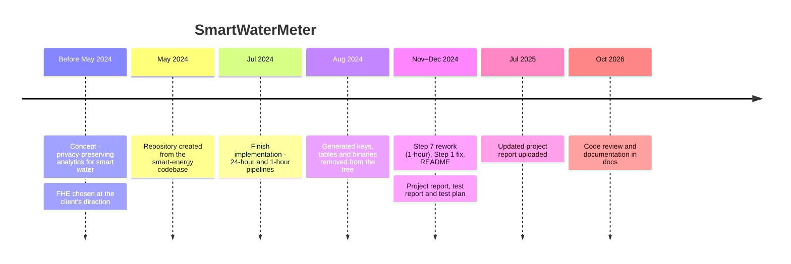

# System Evolution

This document records how SmartWaterMeter reached its current form: the phases of the project, the design decisions made along the way and why, and the state the repository was left in. The dates come from the git history and the project report.

## Timeline

## Phases

### 1. Concept

The project set out to protect customer water-usage data in a smart water grid while still allowing the utility to run analytics on it. Several privacy techniques were considered:

| Option | Why it was not chosen |
|---|---|
| Secure Multiparty Computation | Needs many rounds of interaction between parties, and scales poorly to many meters |
| Differential Privacy | Adds noise to the result, so the ratio used for anomaly detection loses accuracy |
| Fully Homomorphic Encryption | **Chosen.** Gives an exact result on encrypted data. It was also the approach the client asked for |

### 2. Inheriting the smart-energy codebase

The team was given an existing implementation for **smart electricity grids**. It encrypted per-meter energy usage, computed the HM/AM ratio with the LUT + PIR protocol, and decrypted the result. The water project kept that design:

- The same parties: Computation Server and Trusted Authority, alternating in numbered steps.
- The same scheme and library: BFV in Microsoft SEAL.
- The same lookup-table approach for division and reciprocals.

Traces of the origin remain in the code. The constants header is `SGSimulation.hpp` ("smart grid simulation"), some log messages name the TA `DS`, and `CMakeLists.txt` still declares the SEAL examples project.

### 3. Dataset shift: energy to water

The main adaptation was the data. The pipeline was pointed at daily water-usage files (`DateWiseData/NormalWinso/2014/<date>.txt`, one row per hour, one column per meter), with `METER_NUM = 150`. Changing the data meant:

- Reading the new file format in `ReadData` (`Utility.hpp`).
- Regenerating the lookup tables for the range of water readings. The tables cover readings from about 50 to 6000 after the transform $x = \ln(w + 2)$.
- Keeping the `TABLE_SIZE_*` constants, which tell each step how many table rows to load, in step with the new tables. They are out of step today (known issue 1).

The dataset is not in the repository: the team was given permission to use it only for a specific period.

### 4. Two pipeline variants

The July 2024 implementation has two variants of the same protocol:

| Variant | Idea | Outcome |
|---|---|---|
| `src/24hour` | Process a whole day in each step; `script.py` loops over every day of 2014 | The main pipeline. Steps 1–7 and `CheckRes` exist; see the known issues before relying on results |
| `src/1hour` | Run Steps 1–3 once per hour, keeping a running sum, to model meters that report hourly | Steps 3 and 5 were split into AM and HM programs. It does not complete in its current state |

### 5. Precision experiments

`MakeEncTab_1`, `_2` and `_3` generate the same tables at three precision levels ($2^9$, $2^7$, $2^5$ for the hourly outputs). The report's "Precision and Scaling" section describes the trade-off: more precision means larger tables and longer runs. Only the first level matches the constant in `CheckRes`. See [LOOKUP_TABLES.md](LOOKUP_TABLES.md#precision-variants).

### 6. Testing and validation

Testing compared the decrypted encrypted result with the plaintext result that `Step1_CS1` computes from the same data. The test report also covers the utility functions and a scaling metamorphic test. See [TESTING.md](TESTING.md) for what was and wasn't tested.

### 7. Handover and review (2025–2026)

After the course ended, the updated report was uploaded (July 2025). In October 2026, a code review compared the code with the report and wrote down every issue it found ([KNOWN_ISSUES.md](KNOWN_ISSUES.md)). The documentation in `docs/` was written at the same time. No source code has changed since December 2024.

## Design decisions

Reasons marked *Reconstructed* are inferred from the code and its parameters. The report does not state them. The other reasons come from the report.

| Decision | Alternatives | Reason |
|---|---|---|
| BFV scheme | CKKS (approximate real numbers), TFHE (bitwise) | *Reconstructed:* BFV computes exact integer results and supports batching. CKKS would avoid integer scaling but gives approximate results. Bitwise schemes are much slower |
| Integer encoding with power-of-two scaling | Bitwise encoding | Much faster; the precision is chosen with the scaling exponents |
| LUT + PIR for division and reciprocal | Polynomial approximation of $1/x$ | BFV has no division. A lookup gives an exact table value, and each lookup resets the multiplicative depth (see [noise model](SYSTEM_MODELS.md#fhe-parameter-and-noise-model)) |
| Digit split in base 100 | Larger plain modulus | The product $2^{30} Q_d$ would not fit in $t_p = 786433$. A larger plain modulus costs noise budget and execution time |
| $\ln(w + 2)$ transform | Raw readings (as in the report) | *Reconstructed:* compresses the range of readings, which keeps the tables small, and avoids $1/0$ |
| One step per executable, data in files | One program, or a networked service | *Reconstructed:* matches the multi-party model and lets each step be timed and rerun on its own |
| `poly_modulus_degree = 8192` | 4096 or 16384 | *Reconstructed:* enough noise budget for three multiplications at 128-bit security, and 4096 slots per table row |

## State of the repository

- The 24-hour pipeline is the reference implementation.
- The 1-hour pipeline is incomplete.
- The source has not changed since December 2024. The known issues, including several that stop a full run, are written down but not fixed.
- There are no automated tests or CI.

[CONCLUSION.md](CONCLUSION.md) sums up what the project achieved and what to do next.
